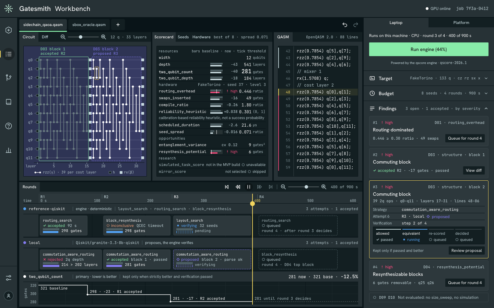
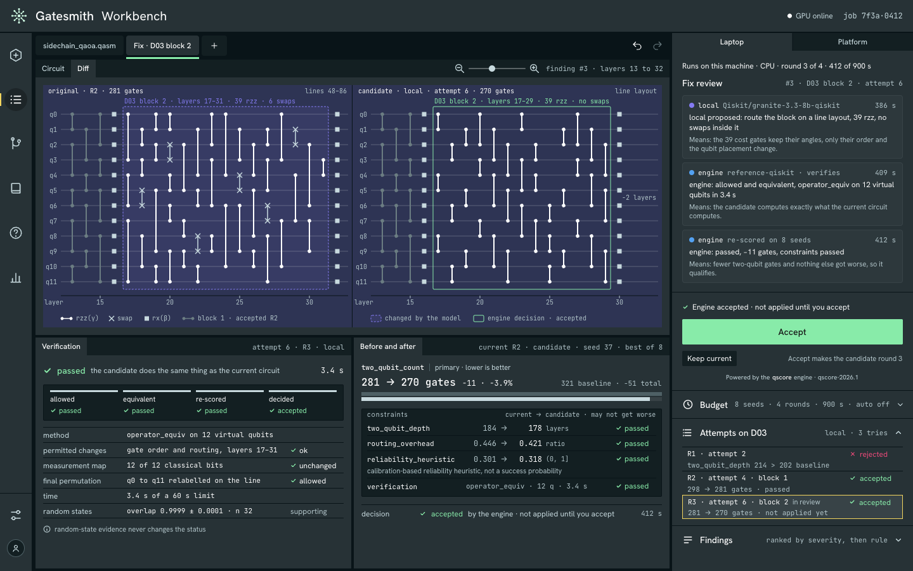
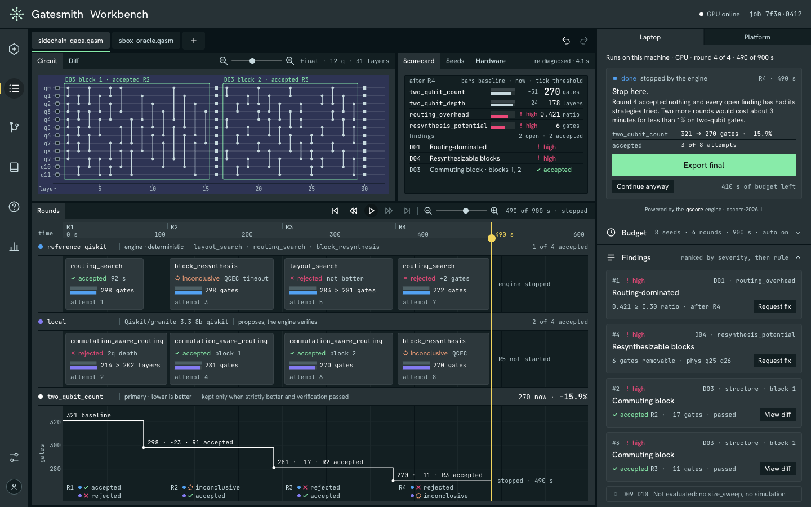
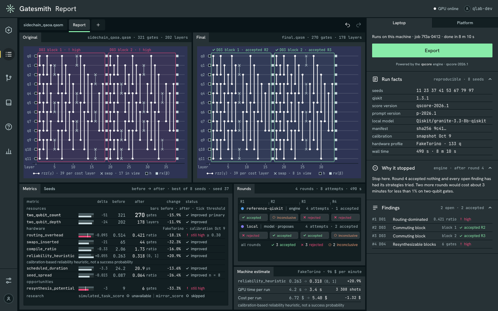
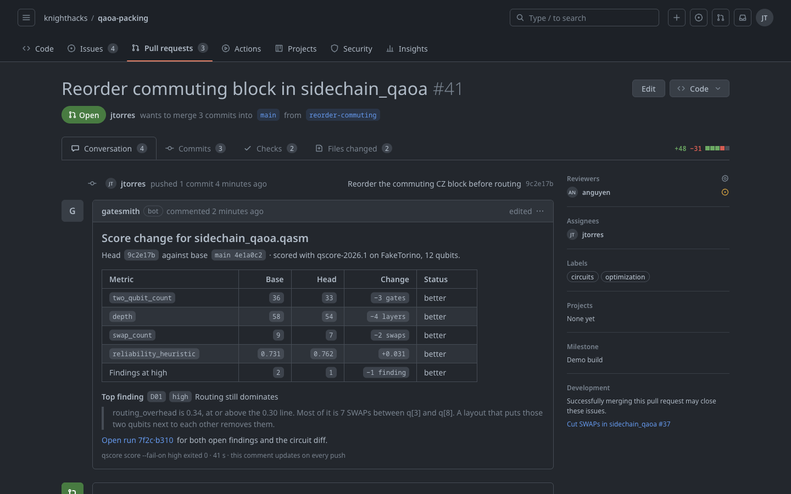
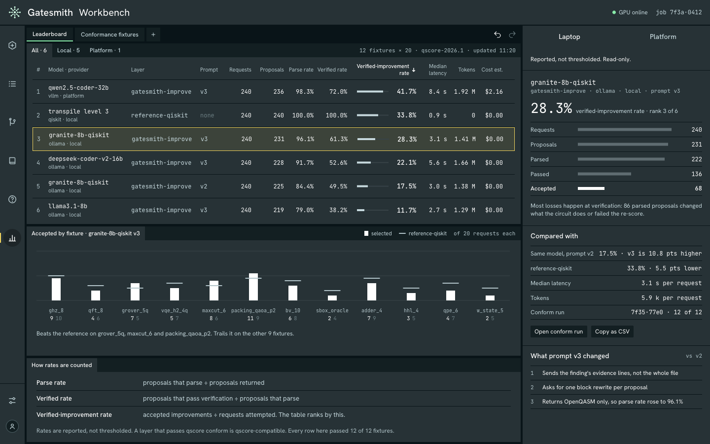

<p align="center">
  
</p>

<p align="center">
  <a href="LICENSE"></a>
  <a href="https://github.com/GatesmithKnightHacks/Gatesmith/actions/workflows/ci.yml"></a>
  <a href="https://www.python.org/"></a>
  <a href="https://www.ibm.com/quantum/qiskit"></a>
  <a href="https://2026.knighthacks.org/"></a>
  
  <a href="https://app.paper.design/file/01M4HRSADT6ENEYVNPGZ0CSW1Z"></a>
</p>

---

**Gatesmith** is a quality check for quantum circuits, done after you write the Qiskit code and before you pay for time on quantum hardware. Its engine, **qscore**, does the following:
- validates a manifest of circuits and explains what it understood;
- compiles each circuit across several seeds on a target device;
- measures the result and diagnoses where the cost comes from;
- places the numbers against public benchmark circuits;
- verifies every proposed rewrite before it counts as better.

The scoring engine works today on any CPU, and one round of the improvement loop runs as an experimental command. The full multi-round loop and the GitHub Action are specified in [`specs/`](specs/README.md), and the sections below mark them as planned. The screenshots are design exports for the web app. Only the baseline scorecard in them comes from the engine, and the other numbers are illustrative. The demo covers Qiskit only.

- Engine: [`qscore/`](qscore/README.md) (Python ≥ 3.11, Qiskit 2.x, [uv](https://docs.astral.sh/uv/))
- Specs (source of truth): [`specs/`](specs/README.md)
- Improvement-loop results: [`docs/improvement-loop-findings.md`](docs/improvement-loop-findings.md)
- Deployment (Vultr, SQLite, Hugging Face): [`qscore/docs/deployment.md`](qscore/docs/deployment.md)

## Install

```bash
git clone https://github.com/GatesmithKnightHacks/Gatesmith.git
cd Gatesmith/qscore
uv sync
uv run qscore --help
```

The engine needs [uv](https://docs.astral.sh/uv/). uv installs the Python version pinned in `qscore/.python-version`, which is 3.12, so the system Python does not matter. CI also tests on Python 3.11.

## Score a circuit

Give `qscore score` one OpenQASM 2 or 3 file. The default target is `FakeTorino`, a 133-qubit fake backend from `qiskit-ibm-runtime`.

```bash
uv run qscore score examples/sidechain_qaoa/circuits/packing_qaoa_p2.qasm --yes
```

```text
packing_qaoa_p2: complete · 4 finding(s) (D01:high, D03:high, D03:high, D04:high) → qscore-out/scorecards/packing_qaoa_p2.json
report → qscore-out/report.md
```

The run writes a JSON scorecard per circuit, a Markdown report and the compiled circuits to `qscore-out/`. The report lists every metric with a status, then the findings. For this 12-qubit QAOA circuit, routing on FakeTorino inserts 65 SWAP gates, and the compiled circuit has 321 two-qubit gates:

<!-- Numbers: qscore/qscore-out/smoke/sidechain_qaoa/report.md on branch t00-bootstrap at commit ff7bee4,
     reproduced with the command above on branch t00-bootstrap at commit 5c2d8a1. -->

```text
| `two_qubit_count` | 321 | gates | ✔ computed |
| `routing_overhead` | 0.514019 | ratio | ✔ computed |
| `swaps_inserted` | 65 | gates | ✔ computed |
```

A `routing_overhead` of 0.514 is past the 0.30 threshold of rule D01, so the report says routing dominates the circuit and names the compiled qubits where the SWAP gates went. It also finds two commuting blocks, D03, and one resynthesizable block, D04. The `reliability_heuristic` for this circuit is 0.263. It is a calibration-based estimate, not a success probability.

The scorecard covers compiled width, size, depth, two-qubit count and depth, swaps inserted, routing overhead, a reliability heuristic, scheduled duration, and the spread across seeds. Each metric is also placed as a percentile among public QASMBench and MQT Bench circuits of similar width on the same target. The corpus has 119 circuits on FakeTorino; failures are recorded, not repaired. Different algorithms are not directly comparable, so the percentiles describe a circuit, not rate it.

Other ways to give the engine a circuit:

```bash
uv run qscore score - --yes                                      # paste OpenQASM, then press Ctrl-D
uv run qscore score circuit.qasm --yes --target line-5           # synthetic targets: line-N, grid-RxC, heavy-hex-D
uv run qscore score --manifest examples/sidechain_qaoa/qscore.yaml --yes
uv run qscore discover https://github.com/<owner>/<repo> --draft --score   # repo link → find circuits → manifest → score
scripts/smoke.sh                                                 # end-to-end smoke test
```

A manifest, `qscore.yaml`, lists the circuits, what must stay the same in each, and what may change. It can point at QASM files or at Qiskit builder functions in a repo. Builder functions run in a sandbox that caps memory with `RLIMIT_AS`, which macOS rejects, so manifests with builders need Linux for now. QASM files and QASM-only manifests work on macOS.

## Read the findings

Ten rules turn metrics into findings. Each finding carries a severity, its evidence, the region of the circuit it covers, and the strategies that could fix it. The thresholds live in `qscore/src/qscore/diagnose/thresholds.yaml` and belong to the score version `qscore-2026.1`.

| Rule | Fires when |
|---|---|
| D01 Routing-dominated | `routing_overhead` is at least 0.30 |
| D02 Seed-sensitive | `seed_spread` is at least 0.15 |
| D03 Commuting block | a commuting run has at least 6 two-qubit gates on at least 4 qubits |
| D04 Resynthesizable blocks | `resynthesis_potential` is at least 1 gate |
| D05 Clifford or linear block | such a block spans 3 to 9 qubits |
| D06 Reliability hot spot | one qubit or edge carries at least 25% of the estimated error |
| D07 Decoherence risk | the scheduled duration reaches half the median T2 |
| D08 Uneven entanglement | per-qubit two-qubit gate counts have a coefficient of variation of at least 0.5 |
| D09 Poor scaling | routing overhead rises across three or more sizes of a sweep, or compiled cost grows faster than logical cost |
| D10 Low task score | the simulated task misses its tolerance; it needs simulation metrics, which the CPU build skips |

A rule whose metric was not computed records why it was skipped instead of passing silently. The workbench shows the scorecard next to the circuit and the QASM, with each finding drawn on both.

<p align="center">
  
</p>

## Fix one finding at a time (experimental)

`qscore improve` runs one improvement round. The engine turns the top findings into improvement requests and sends them to proposers:

- `reference-qiskit` wraps Qiskit's own passes and gives the same answer every time. It cut QASMBench `fredkin_n3` from 12 to 10 two-qubit gates. The circuit is verified equivalent and the gain reproduces on fresh seeds.
- `hf` sends only the requested region to 4 pinned open-weight models through Hugging Face Inference Providers (`qscore/src/qscore/improve/models.yaml`). It has found no improvement so far, and every wrong rewrite was caught (102 of 104 candidates were non-equivalent).
- `local`, a locally served model (`Qiskit/granite-3.3-8b-qiskit` in the specs), is planned.

Models only propose. The engine runs four checks on every proposal before it counts:

1. The change must be permitted. It stays inside the requested region, uses only the target's native gates and coupling map, and leaves the measurements alone.
2. The candidate must be equivalent. Up to 12 qubits an operator comparison proves it on the CPU. From 13 to 15 qubits a unitary check runs on the GPU, and larger circuits go to MQT QCEC.
3. The candidate is re-scored with the same seeds. The primary metric has to be strictly better, and no constraint may get worse.
4. The engine decides whether the candidate is accepted, rejected, inconclusive or invalid. It records every attempt, including the rejected ones.

A circuit is written only if it is strictly better and every constraint holds. Random-state tests count as supporting evidence only, never as a pass. The rules are in [`specs/08-verification.md`](specs/08-verification.md) and [`specs/10-improvement-loop.md`](specs/10-improvement-loop.md).

<p align="center">
  
</p>

## Stop at diminishing returns (planned)

The loop stops at the first of these:

- the budget runs out, counted in rounds, wall time, GPU time or proposals
- two rounds in a row accept nothing
- every open finding is below its threshold
- more than half of a round's attempts are inconclusive

After each accepted change the engine re-scores and re-diagnoses the circuit, so the findings change as the loop runs.

<p align="center">
  
</p>

## Final report and export (planned)

The final report puts the original and the final circuit side by side. It shows the change in every metric, the attempts in each round, the seeds and versions needed to reproduce the run, and the reason the loop stopped.

<p align="center">
  
</p>

## Check pull requests

`--fail-on` makes `qscore score` exit with code 1 when any finding reaches the given severity, so a CI job can block a circuit change today:

```bash
uv run qscore score --manifest qscore.yaml --yes --fail-on high
```

The exit codes are 0 for clean, 1 for findings at or above `--fail-on`, 2 for invalid input, 3 for a runtime failure and 4 for a configuration error.

A GitHub Action that scores the base and the head of a pull request and comments the score change is planned; the review bot in `review-bot/` is its starting point.

<p align="center">
  
</p>

## Compare models (planned)

The leaderboard ranks proposers by verified-improvement rate, which is accepted improvements divided by requests attempted. Every proposer gets the same fixtures and the same budget. It also reports parse rate, verified rate, latency, tokens and cost.

<p align="center">
  
</p>

## Benchmark the GPU (experimental)

`qscore bench` is a CPU vs AMD Radeon PRO W7900 (ROCm Aer) statevector benchmark. It measured 6.7× at 28 qubits in FP64.

## Run the web app

The web app lives in [`web/`](web/README.md). It is built with Vite, React and TypeScript.

```bash
cd web
npm install
npm run dev          # http://localhost:5173
```

Open `#/new` and click through a run. Each screen also has its own route, such as `#/workspace`, `#/fix` and `#/report`, listed in `web/README.md`. `npm run dev` plays a scripted run whose data uses the engine's field names. The deployed build (`VITE_API_MODE=live`) talks to the platform API at `/api`, and browser submission stays off until server-side authorization exists. See [`qscore/docs/deployment.md`](qscore/docs/deployment.md).

## Commands

| Command | Purpose |
|---|---|
| `qscore score` | Validate, compile across seeds, measure, diagnose, report |
| `qscore discover` | Find circuits in a folder or repository link without executing code; draft a manifest |
| `qscore deps` | Prepare an isolated builder environment pinned to the engine's Qiskit version |
| `qscore improve` | One verified improvement round (`--layers reference-qiskit` or `hf`) |
| `qscore reference build` | Rebuild the pinned public reference corpus |
| `qscore bench` | CPU vs ROCm GPU benchmark with an evidence report |

## Development

```bash
cd qscore
uv run pytest -m "not gpu and not platform and not hub and not llm and not slow" -q
uv run ruff check . && uv run ruff format --check . && uv run mypy src && uv run lint-imports
```

The review bot has its own checks in `review-bot/`. CI runs both, then deploys the branch named by the repository variable `DEPLOY_BRANCH` to the Vultr host.

## Repository layout

| Path | Contents |
|---|---|
| `qscore/` | The engine, with its CLI, metrics, rules, improvement loop, platform API, schemas, tests and examples |
| `qscore/docker/` | Container images, Compose stack and deploy scripts for the Vultr host |
| `specs/` | The specs the engine is built from, with change proposals |
| `web/` | The web app |
| `review-bot/` | The GitHub review bot |
| `.github/workflows/ci.yml` | Lint, types, import layers and CPU tests on Python 3.11 and 3.12, review-bot checks, and deploy |

## Contributing

[CONTRIBUTING.md](CONTRIBUTING.md) covers running the engine and the web app, branch names, adding a rule or a metric, issue codes and pull requests.

## License

Gatesmith is released under the Apache License 2.0. See [LICENSE](LICENSE).
